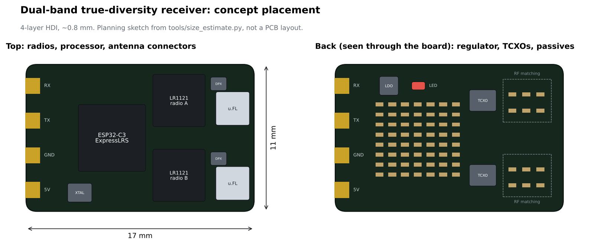
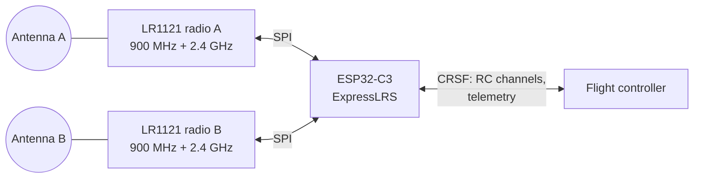
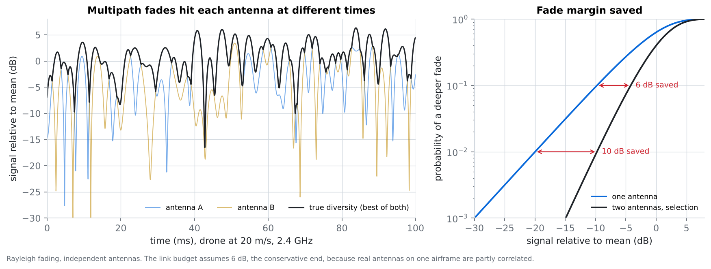
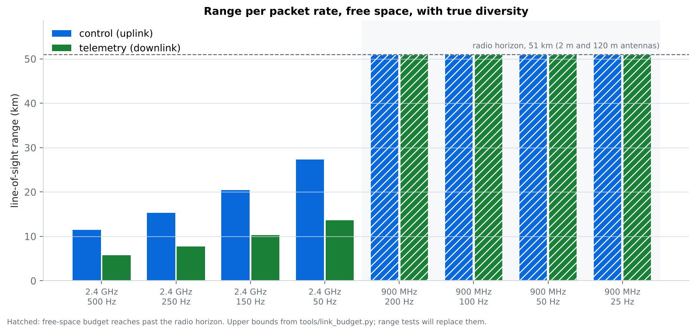

# ELRS

A nano ExpressLRS receiver with dual-band true diversity and full telemetry, built to be as small as the radio
physics allows.

[](https://github.com/aerki-space/ELRS/actions/workflows/ci.yml)



> **Status:** In active development. Hardware design files, firmware targets and validation results will be
> published as they are completed. Specifications below are design targets and may change.

## Key specifications

| | |
|---|---|
| Protocol | ExpressLRS |
| Bands | 900 MHz and 2.4 GHz, simultaneously |
| Diversity | True diversity: two complete radios, two antennas |
| Telemetry | Bidirectional: link quality, flight data, MAVLink |
| Output | CRSF over UART |
| Size | ~17 × 11 mm |
| Antennas | 2 × u.FL, dual-band |
| Input | 5 V |

## Two complete radios, two bands each



Most nano receivers have one radio and one antenna. This one has two full receive chains, each able to work on
900 MHz and 2.4 GHz:

- **True diversity on one band:** both radios listen on the same band through antennas in different places. When a
  propeller arm or a multipath fade blanks one antenna, the other is usually fine.
- **Cross-band:** the transmitter sends every packet on both bands at once, and each radio listens to one. The link
  survives interference or blockage on either band.

## Why diversity is worth the space



With two antennas the receiver uses whichever signal is stronger at that moment. Deep fades on both antennas at the
same time are rare, so the link needs 6 – 10 dB less margin for the same reliability. That is roughly a doubling of
range for the same transmit power.

## Range



- **900 MHz reaches the radio horizon** in every mode on a free-space budget, so curvature of the earth, not the
  radio, sets the limit.
- **2.4 GHz trades range for speed:** 500 Hz packets for racing-grade latency, 50 Hz for distance.
- **Telemetry is the shorter link,** because the receiver transmits from the radio chip with no extra amplifier.
  Failsafes are planned around losing telemetry, not only control.

Free-space numbers are upper bounds. Terrain, trees and the airframe shorten them; range tests will replace them.

## Repository layout

```
docs/
  architecture.md   radios, diversity, telemetry, processor, roadmap
  rf-design.md      dual-band front end, diplexers, antennas, layout rules
  link-budget.md    range estimates per mode (from tools/link_budget.py)
  integration.md    wiring, flight-controller setup, onboard use
hardware/
  README.md         outline, stack-up, pads, size budget
tools/
  link_budget.py    sensitivity and range per mode, control and telemetry links
  size_estimate.py  board-area budget
  plot_figures.py   regenerates docs/img (needs numpy and matplotlib)
tests/              checks for the tools
```

## Quick start

```sh
python3 tools/link_budget.py
python3 tools/size_estimate.py
pip install numpy matplotlib && python3 tools/plot_figures.py   # figures
python3 -m unittest discover -s tests
```

## Roadmap

- Hardware design files
- Firmware target definition
- Range and diversity test results
- Native integration with the AERKI flight controller

More details coming soon.

## License

Hardware design and documentation: MIT, see [LICENSE](LICENSE). ExpressLRS firmware is GPL-3.0, and so is any
firmware change made for this receiver.
