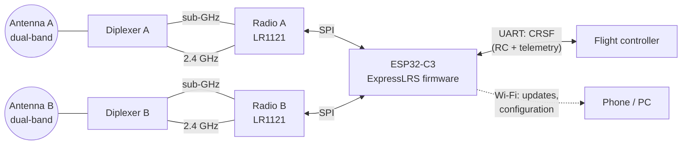

# Architecture

## Block diagram

## Radios: dual-band in every chain

Each diversity chain uses a **Semtech LR1121**: a single transceiver with a sub-GHz radio (900 MHz / 868 MHz ISM)
and a 2.4 GHz radio, supporting LoRa and FSK. ExpressLRS supports the LR1121 for dual-band and "Gemini" modes. Confirm
the exact firmware target before the schematic.

Two complete LR1121 chains give two operating styles:

| Mode | What the receiver does | Use |
|---|---|---|
| Single band, true diversity | Both radios on the same band, each on its own antenna. The firmware keeps whichever packet arrives intact. | Maximum robustness on one band |
| Dual band (cross-band) | The transmitter sends every packet on 900 MHz and 2.4 GHz at once; each radio listens on one band. | Survives interference or blockage on either band |

**Why true diversity matters:** a single antenna on a moving airframe sees deep fades when it's shadowed by the
frame or by multipath. Two antennas in different positions and orientations rarely fade at the same time. With
selection diversity, the fade margin needed for the same reliability drops by roughly 5 to 8 dB.
`tools/link_budget.py` assumes 6 dB.

## Telemetry

ExpressLRS telemetry runs in the downlink slots of the same link.
- **Link statistics:** RSSI, link quality and SNR for each antenna.
- **Flight-controller telemetry over CRSF:** battery, GPS position, attitude and flight mode.
- **MAVLink pass-through:** for ground-control software, on ExpressLRS versions that support it. This needs a lower
  packet rate.

The receiver transmits telemetry from the LR1121's own power amplifier, up to about +20 dBm on sub-GHz and about
+12 dBm on 2.4 GHz, with no external amplifier. This keeps the board small. It also makes telemetry the shorter of
the two links; see [link-budget.md](link-budget.md).

## Processor

- **Chip:** an ESP32-C3 with flash inside the package, so there's no separate flash chip. It's the receiver
  processor current ExpressLRS targets use.
- **Connections:** two SPI devices (one per radio), UART for CRSF, and Wi-Fi for configuration and firmware updates.
- **Size:** about 5 × 5 mm, the largest single part on the board.

## Power

- **Input:** 5 V from the flight controller, regulated to 3.3 V on the board.
- **Draw:** roughly 0.3 – 0.5 W with telemetry at full power and both radios receiving. Wi-Fi mode, used only on the
  bench, draws more.

## Roadmap

- **Flight-controller module:** a version that solders directly onto the AERKI flight controller. It shares its 5 V
  and UART, and its antennas mount on the frame.
- **Higher integration:** future flight-controller revisions are planned around a custom SoC. Bringing the RC radio
  into that platform is part of the long-term plan.
- **Additional bands:** the LR1121 can also work in the 1.9 – 2.1 GHz S-band used for satellite IoT links. That's
  not part of ExpressLRS today; it's noted as a future option only.
